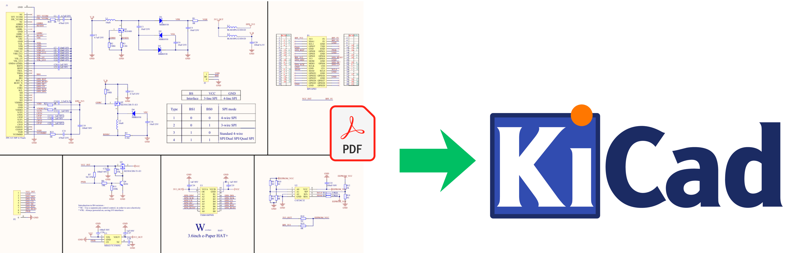
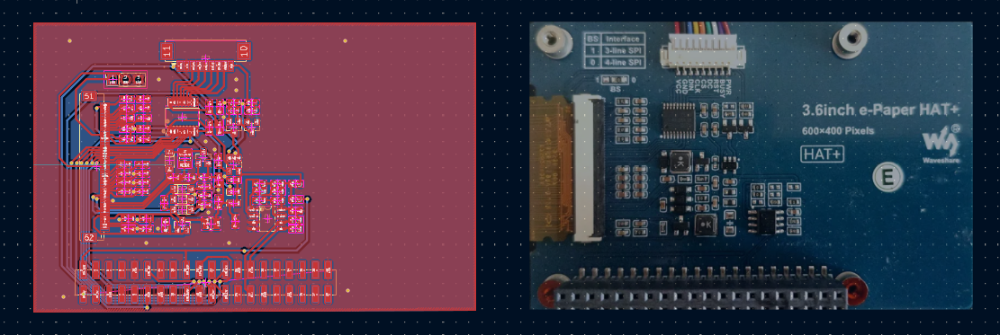

# Waveshare 3.6inch e-Paper HAT+ Schematic Replication

## Overview

This project is a replication of the **Waveshare 3.6inch e-Paper HAT+** schematics, originally documented in `3.6inch_e-Paper_HAT+_Schematics.pdf`. The goal is to recreate the schematic faithfully in **KiCad** for learning, modification, or custom PCB development purposes.

The original hardware is a 600×400 pixel e-paper display HAT designed for the Raspberry Pi/ESP32, manufactured by Waveshare.






📄 **[View Original Schematic (PDF)](./3.6inch_e-Paper_HAT+_Schematic.pdf)**

---

## Source Reference

- **Original schematic:** `3.6inch_e-Paper_HAT+_Schematics.pdf`
- **Source link:** https://www.waveshare.com/wiki/3.6inch_e-Paper_HAT%2B_(E)_Manual?srsltid=AfmBOorWlnluAFoRzEwT3edqMAU8t9G03QhICEiQ9qgBs1PhjLsAxZD9#Precautions
- **Manufacturer:** Waveshare
- **Product:** 3.6inch e-Paper HAT+ (600×400 pixels)
- **Interface:** SPI (3-line or 4-line, selectable via BS0/BS1)

---

## Project Structure

```
├── .gitignore
├── README.md
├── 3.6inch_e-Paper_HAT+_Schematic.pdf  # Original Waveshare reference schematic
├── Hat_Eink_Esp32.bak                  # KiCad schematic backup
├── Hat_Eink_Esp32.kicad_sym            # Custom symbol library
├── Schematics.kicad_pcb                # PCB layout file
├── Schematics.kicad_prl                # Project local settings
├── Schematics.kicad_pro                # KiCad project file
├── Schematics.kicad_sch                # Main schematic file
└── coil_maker.py                       # Helper script
```

---

## TODO

- [ ] **Double check initial schematics** — verify all connections, net labels, and pin mappings against the original PDF before proceeding further
- [ ] **PCB layout** — no board layout has been started yet; component placement and trace routing still needed
- [ ] **Test on real hardware** — validate the completed board against a physical microprocessor and e-paper display to confirm correct operation
- [ ] **Review unnecessary components** — some components from the original Waveshare driver circuit may not be needed depending on the target use case; evaluate what can be simplified or removed

---

## License

This replication is for educational and personal use only. All original design rights belong to **Waveshare Electronics**.
